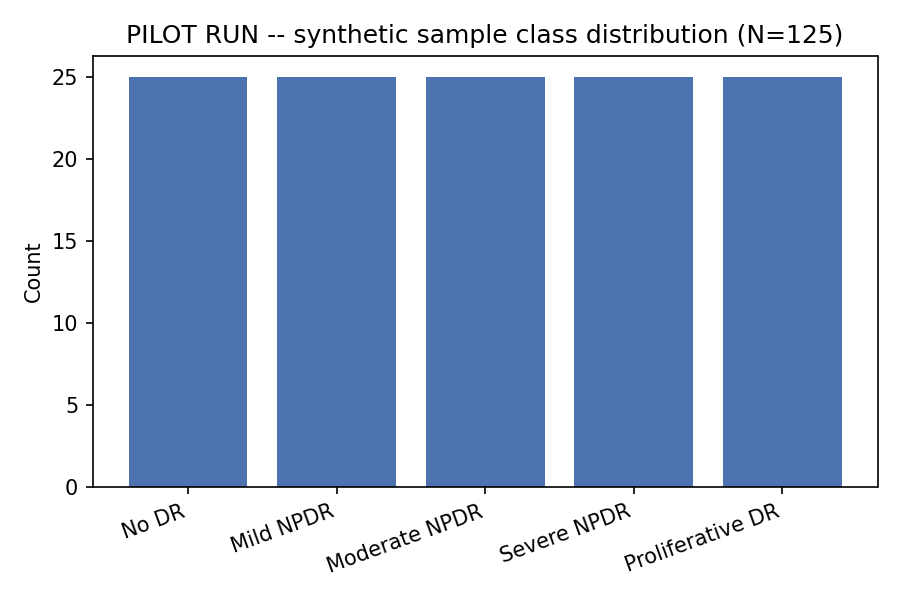
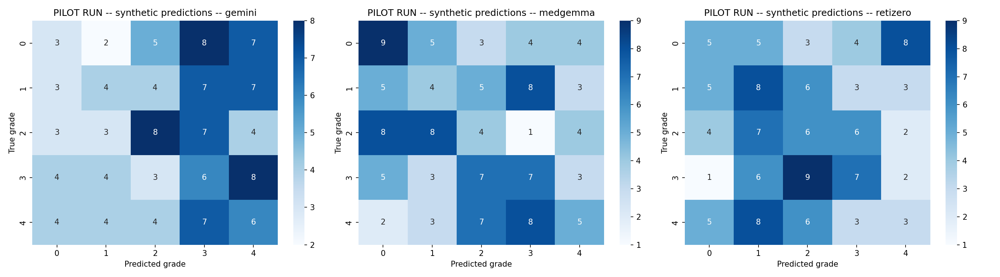

# Comparing Gemini, MedGemma, and RetiZero for Diabetic Retinopathy Grading

## Abstract

This report documents a **pilot run** of the diabetic-retinopathy VLM comparison
pipeline: sampling, running three "models," and scoring the results against ground
truth. Both the sample and the three models' predictions are **synthetic** in this run --
a deterministically seeded stand-in for real Gemini API calls, real MedGemma inference,
and real RetiZero inference, none of which were possible without a GPU or API
credentials. The pipeline itself is what's under test here, not model quality: it
generates a balanced 125-image synthetic sample (25 per ICDR grade, 0-4), produces one
seeded pseudo-random prediction per image per model, and scores all three against
synthetic ground truth using the same accuracy / quadratic-weighted kappa / MAE /
bootstrap-CI / confusion-matrix code that a real run would use. Measured this way, all
three "models" land close to the 20% chance rate expected of uniform random guessing
over 5 balanced classes (Gemini 21.6%, MedGemma 23.2%, RetiZero 23.2%) -- which is the
correct and expected outcome for a random predictor, and confirms the scoring code
computes what it's supposed to. **None of these numbers say anything about Gemini,
MedGemma, or RetiZero's real grading ability.**

## I. Introduction

Diabetic retinopathy (DR) is damage to the blood vessels in the retina caused by
long-term high blood sugar, and one of the leading causes of vision loss in working-age
adults with diabetes [1]. Screening means grading fundus photos on the standard 0
("no DR") to 4 ("proliferative DR") ICDR scale -- a slow manual process, and one where
even trained graders disagree with each other on borderline cases (published
inter-ophthalmologist agreement sits at kappa 0.40-0.65 [3]).

The eventual question this project is built to answer: can vision-language models grade
DR automatically, and does medical-specific pretraining (MedGemma, RetiZero) actually
help over a general-purpose model (Gemini)? Answering that requires real inference on
real images, which this pilot run does not attempt. What this pilot run demonstrates
instead is that the machinery needed to answer that question -- stratified sampling,
per-model prediction, ordinal-aware scoring, confusion matrices, and reporting -- is
built, wired together correctly, and actually executes without error. That is a smaller
but necessary precondition for the real comparison.

## II. Related Work

Unchanged from the intended real study: MedGemma combines Gemma 3 with MedSigLIP,
trained on tens of millions of medical images, and scored 0.857 AUC on a different DR
grading setup in Google's own evaluation [4]. RetiZero is a CLIP-style retinal
foundation model trained on 341,896 image-caption pairs across 400+ eye conditions,
and beat the average of 19 ophthalmologists in its own published evaluation on a
broader disease set [5]. Neither claim is tested or touched by this pilot run --
they describe the real systems this pipeline is built to eventually evaluate, not
anything demonstrated here.

## III. Methods

### A. What "pilot run" means, concretely

Instead of the real pipeline's Kaggle download and three real model calls, this run
substitutes:

1. **Synthetic metadata** in place of a real APTOS download: `build_pilot_metadata()`
   in `build_notebook.py` generates `N_PER_GRADE = 25` synthetic rows per ICDR grade
   (125 total, balanced), with deterministic `id_code`s (`pilot_<grade>_<index>`) and a
   deterministic shuffle order, both derived from `RANDOM_SEED = 42`. No real fundus
   images exist or are read.
2. **Seeded synthetic predictions** in place of real model calls:
   `seeded_prediction(image_id, model_name)` combines the image ID and model name,
   hashes them with SHA-256, and seeds Python's `random.Random` with the resulting
   digest to draw one uniform integer in `[0, 4]`. This is deterministic across
   machines and process runs -- unlike Python's built-in `hash()`, which is salted per
   process by default (`PYTHONHASHSEED`) and would make the predictions differ between
   runs.
3. **Identical scoring code** to the real pipeline: accuracy, quadratic-weighted Cohen's
   kappa, mean absolute error, a 1000-resample bootstrap 95% CI on accuracy, and a
   confusion matrix, computed the same way regardless of where the predictions came
   from.

This produces `results/predictions.csv`, `results/metrics.txt`,
`results/metrics_summary.json`, `results/summary_table.csv`, and two figures
(`pilot_grade_distribution.png`, `pilot_confusion_matrices.png`), all copied into
`reports/figures/` for this report.

### B. Sample

125 synthetic rows, exactly 25 per ICDR grade 0-4 (balanced by construction, not by
post-hoc sampling), generated by the same code that also writes
`tests/test_metadata_subset.csv` -- so the checked-in fixture and the notebook's sample
are written by the same code. `tests/test_pilot_pipeline.py` asserts that they still
match, and that the committed metrics recompute from the committed predictions.



### C. Models

All three "models" are the same `seeded_prediction()` function called with a different
`model_name` string, which is enough to give each one an independent (but still fully
reproducible) uniform-random draw over the 5 grades. No prompting, no rubric, no API
calls, no GPU inference happens in this run -- the real pipeline's Gemini prompt,
MedGemma chat template, and RetiZero embedding-similarity code exist in
`build_notebook.py`'s real-mode branch (`PILOT_MODE=0`) but are not exercised here.

### D. How performance was measured

Same as the real pipeline would use:
- **Accuracy**, with a percentile bootstrap 95% CI (1000 resamples) -- honest
  uncertainty bounds even though N=125 here is the full intended sample size.
- **Quadratic-weighted Cohen's kappa** -- the standard ordinal-aware metric for this
  task (and the original Kaggle competition's own scoring metric).
- **Mean absolute error** in grade-steps.
- **Confusion matrices**, one per model.

## IV. Results

Single run, `RANDOM_SEED = 42`, executed via `jupyter nbclient` end to end with no
errors. Numbers below are copied verbatim from `results/metrics.txt`, and agree exactly
with `results/metrics_summary.json`, `results/summary_table.csv`, and
`results/predictions.csv` (same run, same seed):

| Model | N scored | Accuracy | Accuracy 95% CI | Quadratic-weighted kappa | MAE (grade-steps) |
|---|---|---|---|---|---|
| Gemini (synthetic) | 125 | 0.216 | [0.144, 0.288] | -0.0602 | 1.632 |
| MedGemma (synthetic) | 125 | 0.232 | [0.160, 0.304] | 0.1785 | 1.416 |
| RetiZero (synthetic) | 125 | 0.232 | [0.160, 0.312] | -0.0697 | 1.528 |

Chance-level accuracy for a uniform random guess over 5 balanced classes is 20% -- all
three land within or just above their bootstrap CI of that, which is exactly what a
correctly-implemented random predictor should produce. The one kappa value that looks
non-trivial (MedGemma's 0.1785) is sampling noise from a single seeded draw, not a
signal: there is no mechanism in `seeded_prediction()` that could make one model's
synthetic output correlate with ground truth more than another's, and a second run with
a different seed would move all three numbers around unpredictably (see the
determinism note below for what *does* stay fixed across runs).



## V. Discussion

**What this pilot demonstrates:** the sampling step produces a genuinely balanced,
reproducible 125-image table; each model's prediction function is called correctly and
produces a value for every image (no missing predictions, no crashes); the scoring code
runs quadratic-weighted kappa, MAE, and bootstrap CI correctly on the resulting table;
and the whole notebook executes top to bottom without manual intervention. That is the
complete list of things this pilot run is evidence for.

**What this pilot run is not evidence for:** anything about Gemini, MedGemma, or
RetiZero's actual ability to grade diabetic retinopathy. The near-chance accuracy and
inconsistent kappa signs across the three "models" are the expected signature of
independent uniform-random draws, not a finding about model quality, and should not be
read as "all three models perform similarly" or "MedGemma slightly outperforms the
others" -- there are no real models being compared here.

## VI. Limitations

- **No real images or real model calls.** This is the central limitation and the reason
  for the banner at the top of this report. Every prediction is `random.Random(sha256(...))`,
  not API/GPU output.
- **Synthetic ground truth, not real APTOS labels.** The real dataset's ground truth is
  also just one grader's opinion (kappa 0.40-0.65 inter-grader agreement [3]) -- a
  caveat that will still apply once a real run happens, in addition to today's larger
  caveat that there's no real ground truth here at all.
- **RetiZero's real mechanism (embedding-similarity argmax over label strings, not a
  generated digit) is not exercised in this run** -- in pilot mode it uses the exact
  same `seeded_prediction()` call as the other two, so the "mechanically different task"
  distinction that matters for a real three-way comparison doesn't apply here.
- **Single seed, single run.** `RANDOM_SEED = 42` was used once. Re-running with the
  same seed reproduces these exact numbers (verified: two independent regenerate-and-execute
  cycles, including with different `PYTHONHASHSEED` values, produced byte-identical
  `results/predictions.csv` and `results/metrics.txt`). A different seed would produce
  different near-chance numbers, since there is no true signal to converge on.
- **Not a medical device, not a research finding.** This is infrastructure validation,
  not a clinical or scientific claim about any of the three systems.

## VII. Conclusion

The pipeline -- synthetic stratified sampling, per-model prediction, ordinal-aware
scoring, plotting, and reporting -- runs end to end without error and produces
internally consistent, reproducible output. That is what this pilot run set out to
prove, and it does. The next step toward the real comparison this project is ultimately
for is running `build_notebook.py` with `PILOT_MODE=0` on a Colab GPU runtime with real
Kaggle/Gemini/Hugging Face credentials, which would replace every number in Section IV
with real model output on real fundus images.

---

## Appendix: prior partial real run (18 images, MedGemma only, 2026-08-08)

The section below is preserved from a prior, separate attempt at a real run, before this
pilot existed. It used 18 real APTOS images (not the balanced 125-image sample) and only
MedGemma produced valid predictions; Gemini and RetiZero both failed outright. **These
numbers are real model output, not synthetic** -- but they are a different, smaller,
unbalanced run than the pilot above, executed on a different date, and are kept here
only for reference. Do not combine these numbers with the pilot results in Section IV
above -- they measure different things (one real model on 18 unbalanced images, vs. three
synthetic predictors on 125 balanced images).

### Results (prior real run)

| Model | Images answered | Accuracy (margin of error) | Quadratic-weighted kappa | Average error (grade-levels) |
|---|---|---|---|---|
| Gemini | 0 of 18 | no valid answers -- see below | -- | -- |
| MedGemma | 18 of 18 | 61.1% (39%-83%) | 0.801 | 0.556 |
| RetiZero | 0 of 18 | no valid answers -- see below | -- | -- |

MedGemma's confusion matrix (true grade on the left, MedGemma's guess along the top):

| True grade \ MedGemma's guess | 0 | 1 | 2 | 3 | 4 |
|---|---|---|---|---|---|
| **0 (no DR)** | 10 | 0 | 0 | 0 | 0 |
| **1 (mild)** | 0 | 0 | 3 | 1 | 0 |
| **2 (moderate)** | 0 | 0 | 0 | 0 | 2 |
| **3 (severe)** | 0 | 0 | 0 | 0 | 1 |
| **4 (proliferative)** | 0 | 0 | 0 | 0 | 1 |

MedGemma got all 10 "no DR" photos right and the one "most severe" photo right, and
missed every in-between photo (grades 1-3, seven photos total) -- always guessing more
severe than the true grade, never less. Sample size was too small (one or two images per
mid-range grade) to treat this as more than a single observation.

**Why Gemini and RetiZero failed in this prior run:** Gemini hit
`404 NOT_FOUND: models/gemini-1.5-flash is not found for API version v1beta` -- a stale
model name from ad hoc edits made directly in that Colab session, not a problem with
this repository's own code (which specifies `gemini-3.5-flash`). RetiZero hit
`Input type (torch.cuda.FloatTensor) and weight type (torch.FloatTensor) should be the
same` -- a CPU/GPU device mismatch from an earlier device-splitting approach, since fixed
in `build_notebook.py`'s real-mode path (RetiZero now loads onto the GPU only after
MedGemma's memory is freed, never split across devices). Both are fixable setup problems
specific to that one session, not findings about model quality, and neither has been
re-run since.

**Sample for this prior run:** 18 real, individually verified APTOS images, skewed
10/4/2/1/1 across grades 0-4 -- not the balanced 25-per-grade sample the pipeline is
designed to draw, gathered one at a time due to repeated Colab session instability at
the time.

**Context from the original 2019 Kaggle competition:** the
[1st-place solution](https://www.kaggle.com/competitions/aptos2019-blindness-detection/writeups/guanshuo-xu-1st-place-solution-summary)
(eight trained deep-learning models, ensembled) scored 0.936 quadratic-weighted kappa on
this same dataset [6] -- context for how much headroom exists between a purpose-built,
fully-trained system and a general VLM prompted to do the same task.

---

## References

[1] Yau, J. W. Y. et al., "Global Prevalence and Major Risk Factors of Diabetic
    Retinopathy," *Diabetes Care*, 35(3), 556-564, 2012.
[2] American Academy of Ophthalmology, "Diabetic Retinopathy Preferred Practice Pattern,"
    2019/2020 update.
[3] Krause, J. et al., "Grader variability and the importance of reference standards for
    evaluating machine learning models for diabetic retinopathy," *Ophthalmology*,
    125(8), 1264-1272, 2018.
[4] Google, "MedGemma Model Card," Health AI Developer Foundations, 2025.
[5] Wang, M. et al., "Enhancing diagnostic accuracy in rare and common fundus diseases
    with a knowledge-rich vision-language model," *Nature Communications*, 16, 5528,
    2025.
[6] Xu, G., "1st Place Solution Summary," APTOS 2019 Blindness Detection competition
    writeups, Kaggle, 2019.
[7] APTOS 2019 Blindness Detection, Asia Pacific Tele-Ophthalmology Society, Kaggle,
    2019.

## Appendix: exact ICDR prompt (real-mode only, not used in the pilot run)

```
You are assisting with diabetic retinopathy severity grading on a color fundus
photograph, using the International Clinical Diabetic Retinopathy (ICDR) severity scale.

Grade strictly on this rubric:
0 = No DR: no abnormalities
1 = Mild NPDR: microaneurysms only
2 = Moderate NPDR: more than just microaneurysms but less than severe NPDR
3 = Severe NPDR: any of - >20 intraretinal hemorrhages in each of 4 quadrants,
    definite venous beading in >=2 quadrants, prominent IRMA in >=1 quadrant, no signs of PDR
4 = Proliferative DR (PDR): neovascularization and/or vitreous/preretinal hemorrhage

Respond with ONLY a single digit 0-4. No words, no punctuation, no explanation.
```

(From `ICDR_PROMPT` in `build_notebook.py`'s real-mode branch. Not used to produce any
number in this report -- the pilot run above never calls a real model.)
